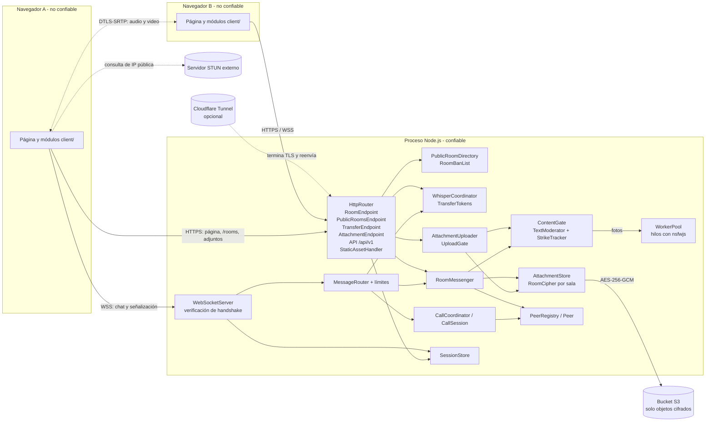
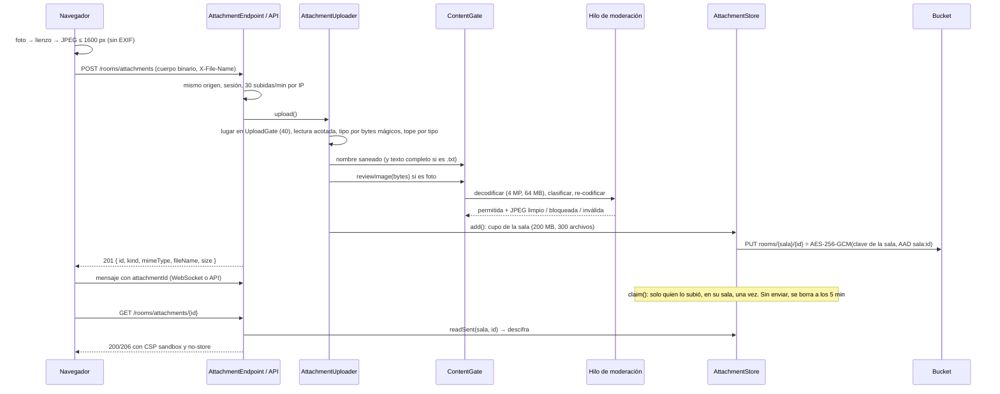

# Arquitectura

## Contexto

MiniWasp es un chat de salas temporales (hasta 20 personas por sala) con adjuntos, moderación de
contenido y videollamadas uno a uno entre navegadores. Las salas son privadas (por invitación) o
públicas (listadas en la portada, con moderación estricta); desde una sala pública dos personas
pueden pasar a un susurro, una sala privada solo para ellas. Un único proceso Node.js sirve la página,
autentica a las personas, modera lo que se publica, cifra los adjuntos y hace de servidor de
señalización WebRTC. El audio y el video viajan directamente entre los navegadores; el servidor nunca
los recibe.

| Aspecto | Decisión |
|---|---|
| Runtime | Node.js 22 o superior, módulos ES |
| Dependencias de producción | `ws` (WebSocket), `@aws-sdk/client-s3` (bucket), `jpeg-js` (decodificar y re-codificar fotos), `nsfwjs` con `@tensorflow/tfjs` y `@tensorflow/tfjs-backend-wasm` (moderación de imágenes local) y `buffer` |
| Frontend | HTML, CSS y JavaScript sin framework ni librerías de terceros |
| Medios | WebRTC del navegador, P2P, DTLS-SRTP, solo llamadas de dos personas |
| STUN y TURN | STUN `stun.cloudflare.com:3478` por defecto, configurable. TURN de Cloudflare Realtime opcional, con credenciales de corta duración por llamada (`GET /rooms/ice-servers`) |
| Persistencia | Sesiones, historial (100 mensajes por sala), faltas de moderación y llamadas viven en memoria. Los adjuntos se guardan **cifrados** en un bucket compatible con S3 (en desarrollo y pruebas, en memoria) y se borran al cerrarse la sala |
| Capacidad por defecto | 20 personas por sala, 1 000 salas, 2 000 conexiones, 1 000 sesiones, 40 subidas simultáneas; ver [operations.md](operations.md) |
| Despliegue | Contenedor Docker en Oracle Cloud detrás de un túnel de Cloudflare (`miniwasp.dayle.dev`), con el bucket de adjuntos en Railway Buckets; o proceso local con TLS opcional |

## Componentes y límites de confianza



Fronteras de confianza:

1. **Navegador → servidor.** Todo lo que llega del navegador es no confiable. El servidor valida
   cada mensaje con listas blancas (`src/shared/signal.js`, `src/server/validation.js`), aplica
   límites de frecuencia y tamaño, y nunca usa datos del cliente para decidir permisos.
2. **Servidor → navegador.** El cliente vuelve a validar cada evento (`src/shared/server-event.js`)
   y muestra el contenido de otros usuarios solo con `textContent`.
3. **Navegador ↔ navegador.** Los medios van cifrados con DTLS-SRTP. El servidor de señalización
   podría sustituir huellas DTLS, por eso ambos ven un código de seguridad derivado de las dos
   huellas (ver [webrtc-security.md](webrtc-security.md)).
4. **Cloudflare → contenedor.** La cabecera `CF-Connecting-IP` solo se acepta con
   `TRUSTED_PROXY_HEADER`, y el contenedor solo es accesible a través de ese proxy.
5. **Servidor → bucket.** El proveedor del bucket no es de confianza: solo recibe objetos cifrados
   con AES-256-GCM y una clave por sala que nunca sale de la memoria del proceso. Las credenciales S3
   se configuran como secretos y el endpoint debe ser `https`.
6. **Archivo subido → navegador.** Un adjunto es contenido hostil: se sirve con
   `Content-Security-Policy: default-src 'none'; sandbox`, sin caché, y los documentos siempre como
   descarga (`Content-Disposition: attachment`).

## Flujo de un adjunto



Al cerrarse una sala (`onRoomClosed` en `create-chat-server.js`) se revocan sus sesiones, se cierran
sus conexiones y videollamadas, se borran sus objetos del bucket y la clave de la sala se sobrescribe
con ceros (*crypto-shredding*): si algún borrado fallara, lo que quede es ilegible. Borrar un mensaje,
o que salga del historial de 100, borra también su adjunto.

## Flujo de moderación

Todo lo que una persona publica (mensaje, pie de foto, nombre visible, nombre de archivo, `.txt`,
foto) pasa por `ContentGate`. El texto se normaliza y se compara con el diccionario
(`TextModerator`); las fotos van a un `WorkerPool` de `worker_threads` con nsfwjs sobre TensorFlow.js
WASM, para que el hilo principal (el chat de todas las salas) nunca se congele. Si se bloquea algo,
`StrikeTracker` decide entre advertir, silenciar o expulsar. Detalle completo en
[moderation.md](moderation.md).

## Salas públicas y susurros

| Módulo | Responsabilidad |
|---|---|
| `rooms/room.js` | `RoomVisibility` (`private`, `public`, `whisper`) y `ROOM_KINDS`: perfil de moderación, cupo, si se abre por invitación y si se lista. Una sala pública tiene `title` y un `listingId` distinto de su id interno |
| `moderation/moderation-profile.js` | `ModerationProfiles.STANDARD` y `STRICT` (ver [moderation.md](moderation.md)) |
| `rooms/public-room-directory.js` | Lista de la portada: solo salas públicas con alguien conectado, las más concurridas primero, como mucho 50; tope de 100 salas públicas |
| `rooms/room-ban-list.js` | Huellas HMAC de IP vetadas en una sala pública, mientras exista la sala |
| `rooms/transfer-tokens.js` | Pases de un solo uso, ligados a una sesión, que vencen a los 60 s |
| `whispers/whisper-coordinator.js` | Invitar, aceptar, rechazar, vencer y no aceptar susurros |
| `messaging/slow-mode.js` | Modo lento por sesión en las salas que lo usan |
| `http/public-rooms-endpoint.js` | `GET /rooms/public` y `POST /rooms/public/{listingId}/join` |
| `http/transfer-endpoint.js` | `POST /rooms/transfer`: canjea el pase y entrega la cookie de la sala nueva |
| `http/room-session-issuer.js` | Entrega la cookie de sesión (crear, unirse, mudarse) y guarda la huella de la IP en la sesión |
| `api/api-room-resolver.js` | Elige la sala de un inicio de sesión de la API (privada o pública nueva, invitación o `listingId`) con los mismos límites, perfil y veto que el navegador |
| `api/public-rooms-endpoint.js` | `GET /api/v1/rooms/public`, sin token y con límite por IP |

Los susurros solo existen por WebSocket: necesitan que las dos personas estén conectadas para
invitar, responder y recibir cada una su pase. Secuencia completa:

```mermaid
sequenceDiagram
  participant A as Navegador de Ana
  participant S as Servidor
  participant L as Navegador de Luis
  A->>S: whisper-invite { to: peerId de Luis } (5 por minuto por IP)
  S->>S: ¿sala pública? ¿ambos con nombre en la misma sala, sin otra invitación pendiente? ¿Luis acepta susurros?
  alt no disponible
    S-->>A: whisper-ended { reason: unavailable } (sin revelar el motivo)
  else disponible
    S-->>L: whisper-incoming { whisperId, from }
    L->>S: whisper-accept { whisperId } (o whisper-reject; sin respuesta en 30 s, timeout)
    S->>S: rooms.create({ visibility: whisper }): 2 personas, perfil estricto, sin invitación ni lista
    S-->>A: whisper-ready { whisperId, transferToken de Ana }
    S-->>L: whisper-ready { whisperId, transferToken de Luis }
    A->>S: POST /rooms/transfer { transferToken } con la cookie de Ana
    S->>S: TransferTokens.redeem: un solo uso, misma sesión, 60 s
    S-->>A: 204 + Set-Cookie (sesión nueva en el susurro; la anterior se revoca)
    A->>S: reconexión WebSocket con la cookie nueva
    Note over L,S: Luis hace lo mismo con su propio pase
  end
```

## Mensajes compartidos entre el navegador y la API

`RoomMessenger` (`src/server/messaging/room-messenger.js`) concentra las reglas de enviar, borrar y
reportar mensajes. Lo usan las rutas del WebSocket (`messaging/routes.js`) y la API REST
(`api/messages-endpoint.js`), así que un mensaje enviado por la API llega por WebSocket a quien usa
el navegador y viceversa. Los eventos nuevos del protocolo (`src/shared/events.js`) son
`message-delete` y `message-report` (cliente) y `message-deleted` y `message-reported` (servidor).

## Capas

```text
src/
├── shared/   Reglas comunes: vocabulario del protocolo, límites, tipos de adjunto, validación de señales y eventos
├── server/   Solo Node.js; nunca se publica
│   ├── api/          API REST /api/v1: autenticación Bearer, salas públicas, búsqueda, mensajes, adjuntos, videollamadas, salida
│   ├── attachments/  Attachment, AttachmentStore (cupos y expiración), AttachmentUploader, RoomCipher,
│   │                 detección por firma, nombres seguros, UploadGate, MemoryBlobStorage y S3BlobStorage
│   ├── calls/        CallSession (estado) y CallCoordinator (reglas)
│   ├── chat/         ChatRoom (historial, autoría y reportes)
│   ├── concurrency/  WorkerPool (hilos con cola acotada y tiempo máximo)
│   ├── http/         Router, respuestas, salas (privadas, públicas, traslados), normas, adjuntos, rangos de bytes, archivos públicos, cabeceras
│   ├── messaging/    MessageRouter, rutas por tipo de mensaje, RoomMessenger y SlowMode
│   ├── moderation/   ContentGate, perfiles estándar y estricto, normalizador y diccionario de texto, StrikeTracker, inspección de imágenes
│   ├── observability/ Logger (JSON) y Metrics
│   ├── peers/        Peer, PeerRegistry y ConnectionHeartbeat
│   ├── rooms/        Salas temporales y sus tipos, invitaciones, nombres reservados, expulsiones, lista pública, vetos y pases
│   ├── security/     Sesiones, cookie, origen, límites, dirección real
│   └── whispers/     WhisperCoordinator
└── client/   Se sirve al navegador
    ├── attachments/  Selector, subida, fotos a JPEG (ImagePreparer), notas de voz, dibujo de adjuntos
    ├── calls/        CallController, PeerLink, LocalMedia, CallView, código de seguridad
    ├── chat/         ChatView, conexión WebSocket, guardado del nombre y de las normas aceptadas
    ├── presence/     Lista de personas conectadas
    ├── rooms/        Inicio, crear y entrar a salas (privadas y públicas), lista pública, invitaciones, barra de la sala
    ├── whispers/     Invitaciones a susurrar, preferencia y traslado
    └── common/       Textos, valores guardados y utilidades de DOM
```

Las dependencias van en un solo sentido: `client` y `server` dependen de `shared`, nunca al revés,
y no hay dependencias circulares. Los puntos de composición son `src/server/create-chat-server.js`,
`src/server/index.js`, `src/client/chat/chat-app.js`, `src/client/calls/call-app.js` y
`src/client/app.js`; el resto recibe sus colaboradores por constructor.

## Principios de diseño aplicados

| Principio | Evidencia en el código |
|---|---|
| Responsabilidad única | Una clase por archivo. `CallSession` guarda estado, `CallCoordinator` decide, `Peer` envía, `HttpResponder` escribe respuestas |
| Abierto/cerrado | Tipos de mensaje en `createCallRoutes`, validadores en `EVENT_VALIDATORS`, sanitizadores en `SIGNAL_SANITIZERS`, fases en `PHASE_LAYOUTS`: agregar uno no cambia la lógica |
| Sustitución de Liskov | Los fakes de `test/support` (socket, WebRTC, sesiones) reemplazan a los reales sin cambios en quien los usa |
| Segregación de interfaces | `CallCoordinator` solo usa `find` de su directorio; `CallController` solo las acciones de `CallSignaling` |
| Inversión de dependencias | Las APIs del navegador (`WebSocket`, `getUserMedia`, `RTCPeerConnection`, `fetch`) se inyectan desde `client/app.js`; el servidor recibe sesiones, límites, logger y métricas |
| DRY | `shared/` es la única fuente del protocolo y la validación; los textos están solo en `texts.js`; todas las respuestas HTTP pasan por `HttpResponder` |
| KISS / YAGNI | Sin framework ni base de datos; cada dependencia de producción cubre algo que no conviene escribir a mano (WebSocket, cliente S3, decodificador JPEG, modelo de imágenes) |
| Fachada | `ContentGate` es el único punto de moderación; `RoomMessenger` el único de las reglas de mensajes; `AttachmentUploader` el único recorrido de una subida, igual para el navegador y la API |
| Objeto de valor / tabla de tipos | `ModerationProfile` reúne todo lo que cambia entre una sala privada y una pública, y `ROOM_KINDS` asigna perfil, cupo y visibilidad a cada tipo de sala: ninguna otra pieza pregunta de qué tipo es la sala |
| Estrategia / sustitución | `MemoryBlobStorage` y `S3BlobStorage` comparten `put`, `get` y `deleteMany`; el `ImageInspector` recibe la fábrica de su `WorkerPool`, y las pruebas lo reemplazan sin cargar el modelo |

Umbrales verificados automáticamente por `npm run lint` en `src/`: complejidad ciclomática y
cognitiva ≤ 10 por función, funciones ≤ 30 líneas efectivas, archivos ≤ 250 líneas.

## Decisiones y alternativas descartadas

- **Sin framework web.** La superficie HTTP es pequeña (salas, sesión, salud, métricas y la API REST `/api/v1`); un framework agregaría dependencias y
  configuración sin aportar controles que no estén ya implementados y probados.
- **Estado en memoria.** Las salas son temporales y no hay datos que deban sobrevivir a un reinicio;
  los adjuntos van al bucket solo para no ocupar la memoria del proceso. La consecuencia es que no se
  puede escalar horizontalmente (ver *Una sola instancia* más abajo).
- **Señalización propia sobre WebSocket.** Evita depender de un servicio externo y permite que el
  servidor aplique reglas de autorización y de orden en cada mensaje.
- **P2P sin SFU.** Para llamadas de dos personas no hace falta un servidor de medios, y los medios
  nunca se descifran fuera de los navegadores. Las salas admiten 20 personas, pero las videollamadas
  siguen siendo de dos: en una malla P2P de 20 cada navegador tendría que enviar 19 flujos de video,
  algo inviable en redes y equipos comunes. Llamadas grupales exigirían un SFU.
- **Moderación local en lugar de un servicio externo.** El diccionario y el modelo de imágenes
  (nsfwjs MobileNetV2 sobre TensorFlow.js WASM) corren en el propio proceso: ningún contenido sale
  hacia terceros. A cambio, la detección es más limitada que la de servicios comerciales y no hay
  coincidencia de hashes de material de abuso (ver [moderation.md](moderation.md)).
- **Hilos para el modelo, no procesos ni servicios.** `worker_threads` mantiene el despliegue en un
  solo contenedor y aísla el trabajo de CPU del bucle de eventos. Los hilos arrancan con la primera
  foto, para no consumir memoria si nadie envía imágenes.
- **Cifrado propio antes del bucket.** Con una clave por sala que solo vive en memoria, cerrar la sala
  basta para que sus archivos sean irrecuperables (*crypto-shredding*), aunque el proveedor guarde
  copias. El costo: un reinicio del proceso hace ilegibles los objetos que quedaran.
- **Una sola instancia.** Salas, sesiones, claves y faltas están en memoria. Escalar a varias
  instancias exigiría un almacén compartido (por ejemplo, Redis) para ese estado, enrutar cada sala
  a una misma instancia o compartir las claves de forma segura. Queda como siguiente paso.
