# Evidencia E2E de videollamadas MiniWasp

Generado por `npm run e2e` (scripts/e2e/run-e2e.mjs) el 2026-11-21T04:20:06.004Z.

## Entorno

| Dato | Valor |
|---|---|
| os | Windows_NT 10.0.26300 (win32 x64) |
| osVersion | Windows 11 Home |
| cpuModel | Intel(R) Core(TM) i5-10300H CPU @ 2.50GHz |
| logicalCores | 8 |
| totalMemoryGiB | 15.8 |
| nodeVersion | v24.11.0 |
| date | 2026-11-21T04:20:06.004Z |
| chromeVersion | Chrome 158.0.8127.36 (headless) |
| appUrl | https://localhost:<puerto libre> (60281 en esta corrida) |

## Como reproducir

- `npm install`
- `npm run e2e`

## Resumen

Total 15, PASS 15, FAIL 0.

| ID | Tipo | Escenario | Resultado | Metricas clave | Duracion (ms) |
|---|---|---|---|---|---|
| E2E-01 | Security | Unirse con una invitacion inexistente o mal formada se rechaza | **PASS** |  | 225 |
| E2E-02 | Happy | Ana crea una sala y Luis entra con el enlace copiado | **PASS** |  | 1242 |
| E2E-03 | Happy | Videollamada completa A -> B con medicion | **PASS** | setup 3845 ms; RTT 0 ms | 10774 |
| E2E-04 | Happy | Silenciar y reactivar el microfono durante la llamada | **PASS** |  | 1634 |
| E2E-05 | Happy | Apagar y encender la camara durante la llamada | **PASS** |  | 3139 |
| E2E-06 | Happy | Colgar libera la camara, el microfono y la conexion en ambos lados | **PASS** |  | 93 |
| E2E-07 | Sad | Permiso de camara negado: aviso y ninguna invitacion enviada | **PASS** |  | 4882 |
| E2E-08 | Sad | Rechazar una llamada entrante | **PASS** |  | 176 |
| E2E-09 | Sad | La persona que llama cancela mientras suena | **PASS** |  | 175 |
| E2E-11 | Concurrency | Ambos cuelgan al mismo tiempo | **PASS** | desfase de clics 0 ms | 688 |
| E2E-15 | Recovery | Corte breve del chat durante la llamada: aviso de reconexion y la llamada sigue | **PASS** |  | 24214 |
| E2E-13 | Security | Renovar la invitacion invalida el enlace anterior | **PASS** |  | 3837 |
| E2E-14 | Security | Sacar a una persona: no puede volver con el enlace viejo, si con el nuevo | **PASS** |  | 1028 |
| E2E-10 | Recovery | Reinicio del servidor de senalizacion sin llamada activa | **PASS** | caida 565 ms; inicio tras reinicio 1453 ms | 2943 |
| E2E-12 | Security | Cerrar sesion durante la llamada termina la llamada del otro participante | **PASS** |  | 2221 |

## Detalle por escenario

### E2E-01 - Unirse con una invitacion inexistente o mal formada se rechaza (Security) - **PASS**

**Pasos**

1. En la pantalla #home de Chrome A escribir "hola" en #invite-token y pulsar "Unirme"
2. Escribir un ID con formato valido pero inexistente (22 caracteres base64url aleatorios) y pulsar "Unirme"

**Esperado:** Texto mal formado: "Pega el ID de invitación o el enlace completo" sin llamar al servidor. ID inexistente: POST /rooms/join responde 404, se muestra "La sala no existe o el enlace ya no es válido" y el chat sigue oculto.

**Observado:** Texto mal formado -> "Pega el ID de invitación o el enlace completo"; ID inexistente -> POST /rooms/join 404 y "La sala no existe o el enlace ya no es válido"; chat oculto=true.

**Verificaciones**

- [x] POST /rooms/join responde 404
- [x] El chat permanece oculto

- Errores de consola esperados: 1
  - ana (console:pestana-1): `Failed to load resource: the server responded with a status of 404 (Not Found)`
- Errores de consola NO esperados: 0

**Metricas**

```json
{}
```

**Evidencia**

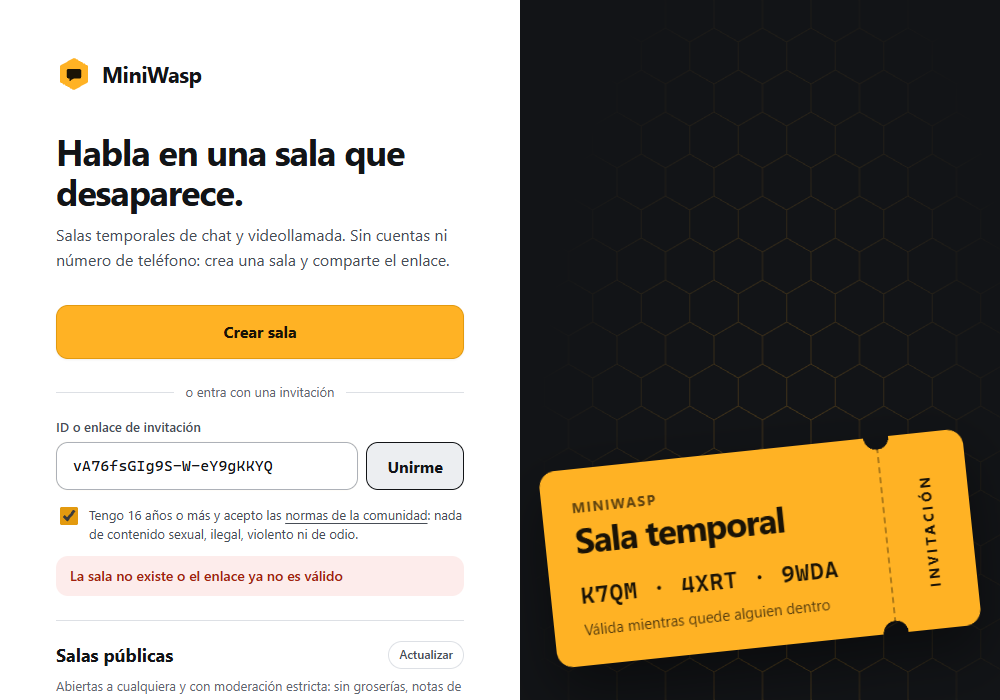

### E2E-02 - Ana crea una sala y Luis entra con el enlace copiado (Happy) - **PASS**

**Pasos**

1. Ana pulsa "Crear sala" (POST /rooms) y espera "En línea"
2. Ana pulsa "Copiar enlace" y se lee el portapapeles
3. Luis abre ese enlace (https://<host>/#join=<token>): entra solo, sin pulsar nada
4. Ambos escriben su nombre y esperan verse en la lista de conectados
5. Revisar insignia, botones de dueno y GET /session en ambos lados

**Esperado:** POST /rooms 204; el portapapeles contiene https://<host>/#join=<token mostrado>; Luis entra con el enlace y el fragmento se borra de la barra de direcciones; ambos se ven; solo Ana ve "Sacar" y "Nuevo enlace"; GET /session da isOwner true/false.

**Observado:** POST /rooms -> 204; invitacion de 22 caracteres; enlace copiado con formato https://<host>/#join=<token>; Luis entro con el enlace y su barra quedo sin fragmento; Ana ve "Sacar", Luis ve la insignia "Creó la sala"; GET /session isOwner Ana=true, Luis=false.

**Verificaciones**

- [x] POST /rooms responde 204
- [x] El enlace copiado apunta a la invitacion mostrada
- [x] La invitacion se borra de la barra de direcciones de Luis
- [x] Luis ve la insignia de quien creo la sala
- [x] Solo Ana ve "Sacar"
- [x] Luis no ve "Nuevo enlace"
- [x] GET /session refleja los roles

- Errores de consola esperados: 0
- Errores de consola NO esperados: 0

**Metricas**

```json
{
  "sessions": {
    "ana": {
      "status": 200,
      "body": {
        "inviteToken": "l5ZuFg1SmYH-Vwu3XFRTNw",
        "isOwner": true,
        "visibility": "private",
        "title": null
      }
    },
    "luis": {
      "status": 200,
      "body": {
        "inviteToken": "l5ZuFg1SmYH-Vwu3XFRTNw",
        "isOwner": false,
        "visibility": "private",
        "title": null
      }
    }
  }
}
```

**Evidencia**

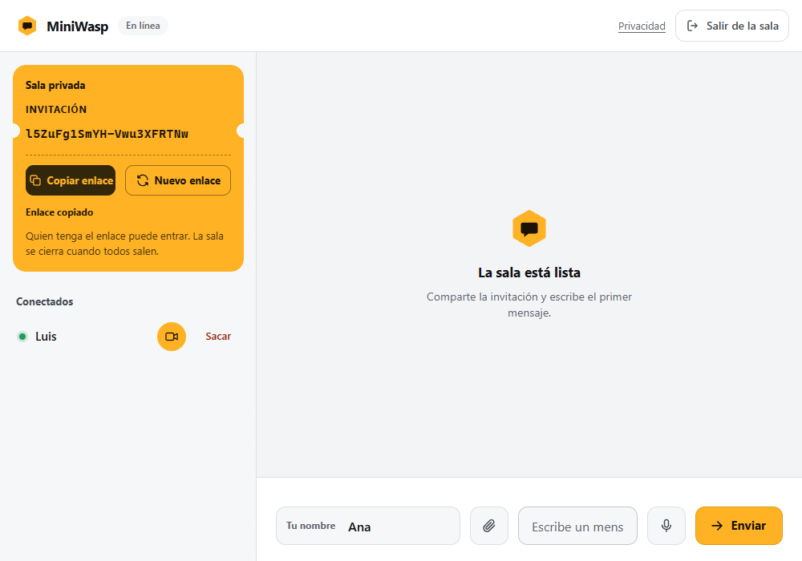
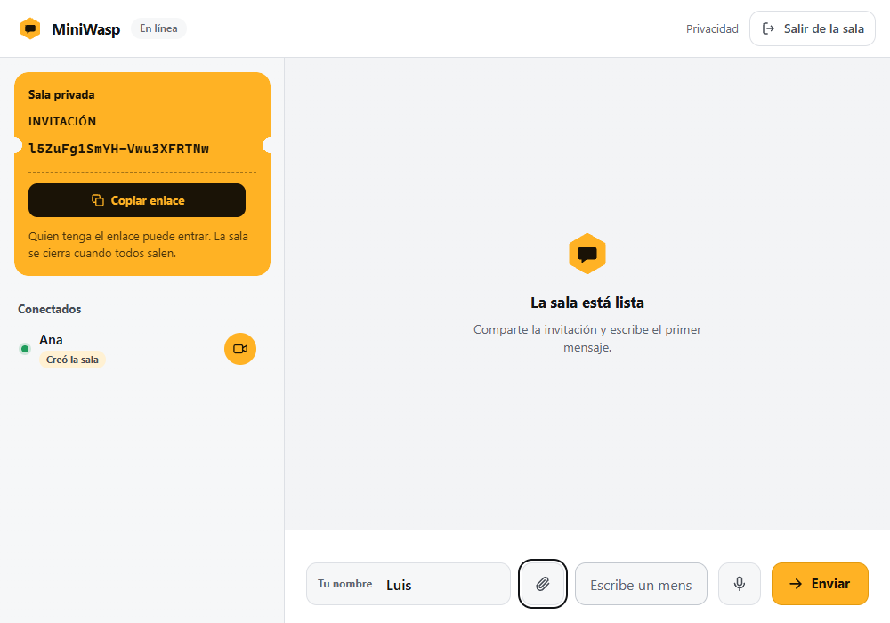

### E2E-03 - Videollamada completa A -> B con medicion (Happy) - **PASS**

**Pasos**

1. Ana pulsa "Videollamar" junto a Luis
2. Luis ve "Videollamada entrante" y pulsa "Contestar"
3. Esperar "En llamada" en ambos lados
4. Verificar que el video remoto tiene dimensiones y que currentTime y los cuadros avanzan en ambos sentidos
5. Leer #call-security-code en ambos lados
6. Tomar getStats() en ambos lados dos veces separadas 5000 ms

**Esperado:** Ambos llegan a "En llamada", ambos ven el mismo "Código de seguridad: NNN NNN NNN NNN", el video remoto avanza en los dos sentidos y getStats() reporta un par de candidatos seleccionado con RTT, jitter y perdida.

**Observado:** Codigo de seguridad Ana "598 129 599 438" / Luis "598 129 599 438". Establecimiento 3845 ms del clic a "En llamada" (3384 ms sin contar la demora en contestar). Video remoto Ana 320x180, Luis 320x180; ambos avanzan. RTT 0/0 ms, jitter video 1/1 ms, perdidos video 0/0 (Ana/Luis).

**Verificaciones**

- [x] Se midio el tiempo de establecimiento
- [x] Ambos ven el mismo codigo de seguridad
- [x] El video de Luis avanza en Ana
- [x] El video de Ana avanza en Luis
- [x] Par ICE seleccionado en Ana
- [x] Par ICE seleccionado en Luis
- [x] Ambos decodifican cuadros de video

- Errores de consola esperados: 0
- Errores de consola NO esperados: 0

**Metricas**

```json
{
  "timeline": {
    "callSetupMs": 3845,
    "calleeAnswerDelayMs": 461,
    "callSetupExcludingAnswerDelayMs": 3384,
    "callerMediaAcquisitionMs": 372,
    "inviteToRingingRoundTripMs": 2,
    "inviteToIncomingMs": 2,
    "calleeMediaAcquisitionMs": 2734,
    "acceptToAcceptedMs": 1,
    "acceptedToOfferSentMs": 22,
    "offerToAnswerMs": 213,
    "answerToCallerActiveMs": 24,
    "callerActiveToCalleeActiveMs": -13,
    "offerSdpLength": 6176,
    "answerSdpLength": 5880
  },
  "securityCodes": {
    "ana": "Código de seguridad: 598 129 599 438. Compruébalo con la otra persona.",
    "luis": "Código de seguridad: 598 129 599 438. Compruébalo con la otra persona."
  },
  "remoteVideoAna": {
    "before": {
      "width": 320,
      "height": 180,
      "currentTime": 0.048166,
      "readyState": 4,
      "hasStream": true,
      "totalVideoFrames": 1
    },
    "after": {
      "width": 320,
      "height": 180,
      "currentTime": 1.558032,
      "readyState": 4,
      "hasStream": true,
      "totalVideoFrames": 32
    },
    "isAdvancing": true
  },
  "remoteVideoLuis": {
    "before": {
      "width": 320,
      "height": 180,
      "currentTime": 0.037079,
      "readyState": 4,
      "hasStream": true,
      "totalVideoFrames": 1
    },
    "after": {
      "width": 320,
      "height": 180,
      "currentTime": 1.546945,
      "readyState": 4,
      "hasStream": true,
      "totalVideoFrames": 31
    },
    "isAdvancing": true
  },
  "statsAna": {
    "connectionState": "connected",
    "selectedPair": {
      "state": "succeeded",
      "currentRoundTripTimeMs": 0,
      "totalRoundTripTimeMs": 4,
      "responsesReceived": 6,
      "local": {
        "candidateType": "host",
        "protocol": "udp"
      },
      "remote": {
        "candidateType": "host",
        "protocol": "udp"
      }
    },
    "currentRoundTripTimeMs": 0,
    "audioJitterMs": 1,
    "videoJitterMs": 1,
    "audioPacketsLost": 0,
    "videoPacketsLost": 0,
    "audioPacketsReceived": 341,
    "videoPacketsReceived": 174,
    "videoFramesDecoded": 133,
    "videoFrameSize": "480x270",
    "bytesReceived": 155687,
    "bytesSent": 149534,
    "windowMs": 5007,
    "inboundVideoKbps": 167.9,
    "inboundAudioKbps": 24.78,
    "decodedFramesPerSecond": 19.97,
    "audioPacketsPerSecond": 50.13
  },
  "statsLuis": {
    "connectionState": "connected",
    "selectedPair": {
      "state": "succeeded",
      "currentRoundTripTimeMs": 0,
      "totalRoundTripTimeMs": 6,
      "responsesReceived": 6,
      "local": {
        "candidateType": "host",
        "protocol": "udp"
      },
      "remote": {
        "candidateType": "host",
        "protocol": "udp"
      }
    },
    "currentRoundTripTimeMs": 0,
    "audioJitterMs": 1,
    "videoJitterMs": 1,
    "audioPacketsLost": 0,
    "videoPacketsLost": 0,
    "audioPacketsReceived": 341,
    "videoPacketsReceived": 167,
    "videoFramesDecoded": 132,
    "videoFrameSize": "480x270",
    "bytesReceived": 149534,
    "bytesSent": 155687,
    "windowMs": 5006,
    "inboundVideoKbps": 162.49,
    "inboundAudioKbps": 24.53,
    "decodedFramesPerSecond": 19.98,
    "audioPacketsPerSecond": 49.94
  }
}
```

**Evidencia**

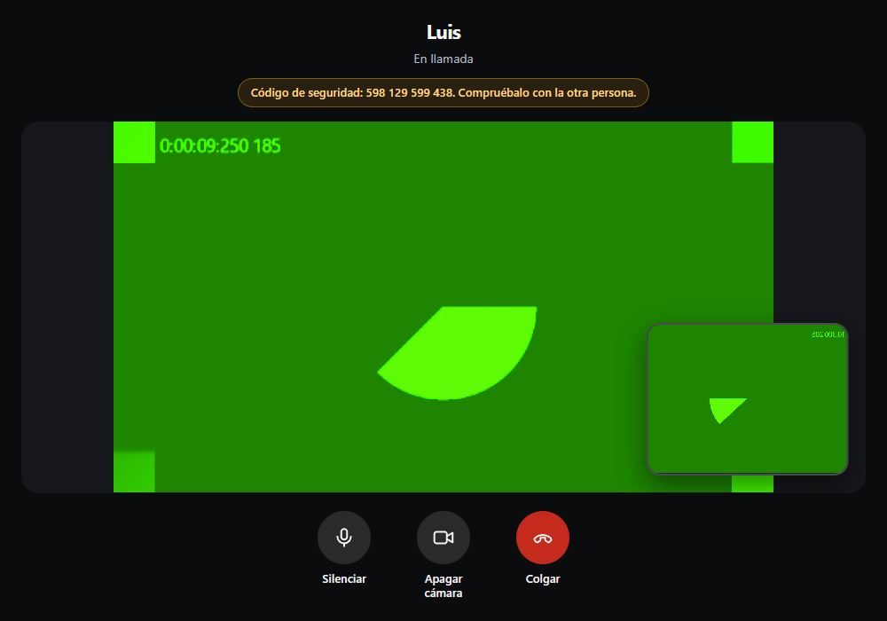
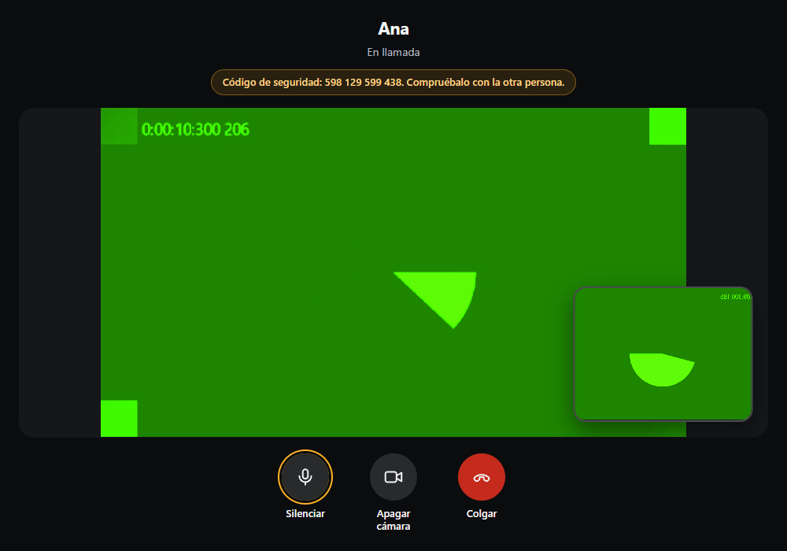

### E2E-04 - Silenciar y reactivar el microfono durante la llamada (Happy) - **PASS**

**Pasos**

1. Con la llamada activa, Ana pulsa #call-microphone
2. Leer la pista de audio del sender de la RTCPeerConnection de Ana
3. Verificar que Luis sigue recibiendo video
4. Ana pulsa #call-microphone otra vez

**Esperado:** Tras el primer clic la pista de audio local tiene enabled=false y el boton dice "Activar micrófono"; el video sigue llegando a Luis; tras el segundo clic enabled=true.

**Observado:** Silenciado: audio enabled=false, boton "Activar micrófono" aria-pressed=true; video en Luis avanza; reactivado: enabled=true.

**Verificaciones**

- [x] Audio local deshabilitado
- [x] Boton refleja el silencio
- [x] Luis sigue recibiendo video
- [x] Audio local reactivado

- Errores de consola esperados: 0
- Errores de consola NO esperados: 0

**Metricas**

```json
{
  "mutedAudioTrack": {
    "kind": "audio",
    "enabled": false,
    "readyState": "live"
  },
  "restoredAudioTrack": {
    "kind": "audio",
    "enabled": true,
    "readyState": "live"
  },
  "remoteVideoLuisWhileMuted": {
    "before": {
      "width": 480,
      "height": 270,
      "currentTime": 6.726858,
      "readyState": 4,
      "hasStream": true,
      "totalVideoFrames": 135
    },
    "after": {
      "width": 480,
      "height": 270,
      "currentTime": 8.232607,
      "readyState": 4,
      "hasStream": true,
      "totalVideoFrames": 165
    },
    "isAdvancing": true
  }
}
```

**Evidencia**

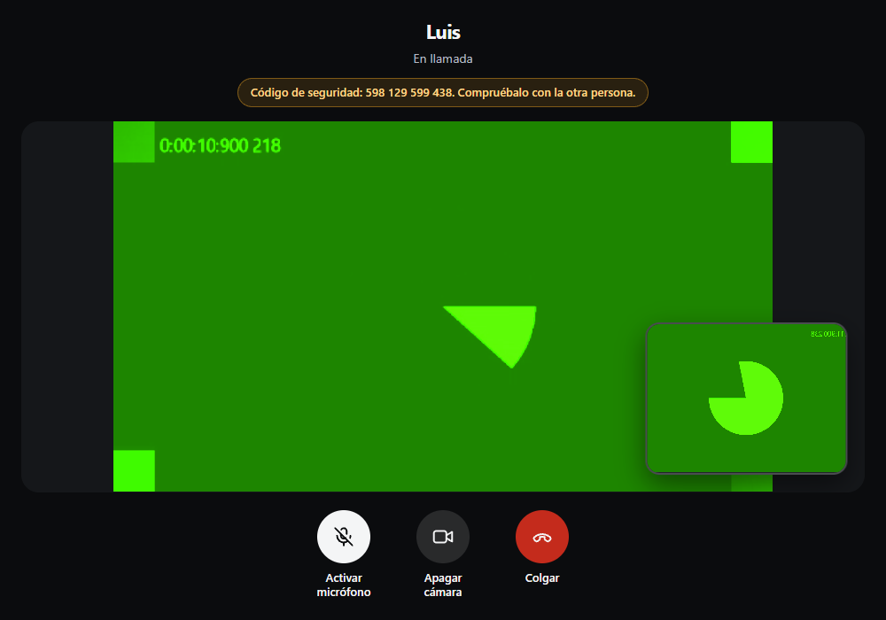

### E2E-05 - Apagar y encender la camara durante la llamada (Happy) - **PASS**

**Pasos**

1. Con la llamada activa, Ana pulsa #call-camera
2. Leer la pista de video del sender de Ana
3. Verificar durante 1500 ms que Luis sigue recibiendo paquetes de audio
4. Ana pulsa #call-camera otra vez y se verifica que el video vuelve a avanzar en Luis

**Esperado:** Tras el primer clic la pista de video local tiene enabled=false y el boton dice "Encender cámara"; el audio sigue llegando; tras el segundo clic enabled=true y el video avanza en Luis.

**Observado:** Camara apagada: video enabled=false, boton "Encender cámara"; paquetes de audio en Luis 429 -> 504; encendida: enabled=true, video en Luis avanza.

**Verificaciones**

- [x] Video local deshabilitado
- [x] Boton refleja la camara apagada
- [x] Luis sigue recibiendo audio
- [x] Video local reactivado
- [x] El video vuelve a avanzar en Luis

- Errores de consola esperados: 0
- Errores de consola NO esperados: 0

**Metricas**

```json
{
  "disabledVideoTrack": {
    "kind": "video",
    "enabled": false,
    "readyState": "live"
  },
  "luisAudioPacketsWhileCameraOff": {
    "before": 429,
    "after": 504
  },
  "remoteVideoLuisAfterRestore": {
    "before": {
      "width": 640,
      "height": 360,
      "currentTime": 9.935488,
      "readyState": 4,
      "hasStream": true,
      "totalVideoFrames": 199
    },
    "after": {
      "width": 640,
      "height": 360,
      "currentTime": 11.451405,
      "readyState": 4,
      "hasStream": true,
      "totalVideoFrames": 229
    },
    "isAdvancing": true
  }
}
```

**Evidencia**

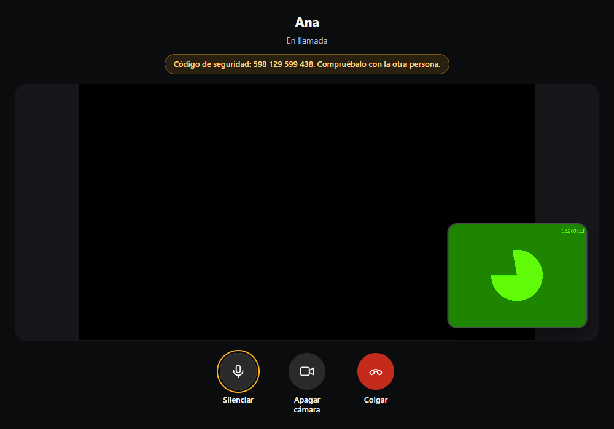

### E2E-06 - Colgar libera la camara, el microfono y la conexion en ambos lados (Happy) - **PASS**

**Pasos**

1. Con la llamada activa, Ana pulsa "Colgar"
2. Esperar que el panel de Luis se cierre
3. Leer readyState de todas las pistas de getUserMedia y connectionState de cada RTCPeerConnection en ambos lados
4. Consultar /metrics

**Esperado:** Luis ve el panel cerrado y "La llamada terminó"; todas las pistas quedan "ended" y las conexiones "closed" en ambos lados; callsActive=0.

**Observado:** Luis ve "La llamada terminó". Pistas Ana: 2 ended; Luis: 2 ended. Conexiones: Ana closed, Luis closed. /metrics callsActive=0.

**Verificaciones**

- [x] Panel de Ana cerrado
- [x] Luis ve el aviso de fin
- [x] Ana libero pistas y conexion
- [x] Luis libero pistas y conexion
- [x] callsActive vuelve a 0

- Errores de consola esperados: 0
- Errores de consola NO esperados: 0

**Metricas**

```json
{
  "releaseAna": {
    "tracks": [
      {
        "kind": "audio",
        "enabled": true,
        "readyState": "ended"
      },
      {
        "kind": "video",
        "enabled": true,
        "readyState": "ended"
      }
    ],
    "peerStates": [
      "closed"
    ]
  },
  "releaseLuis": {
    "tracks": [
      {
        "kind": "audio",
        "enabled": true,
        "readyState": "ended"
      },
      {
        "kind": "video",
        "enabled": true,
        "readyState": "ended"
      }
    ],
    "peerStates": [
      "closed"
    ]
  },
  "serverMetrics": {
    "joinsFailed": 1,
    "roomsCreated": 1,
    "connectionsActive": 2,
    "callsStarted": 1,
    "callsActive": 0,
    "callsEnded": 1
  }
}
```

**Evidencia**

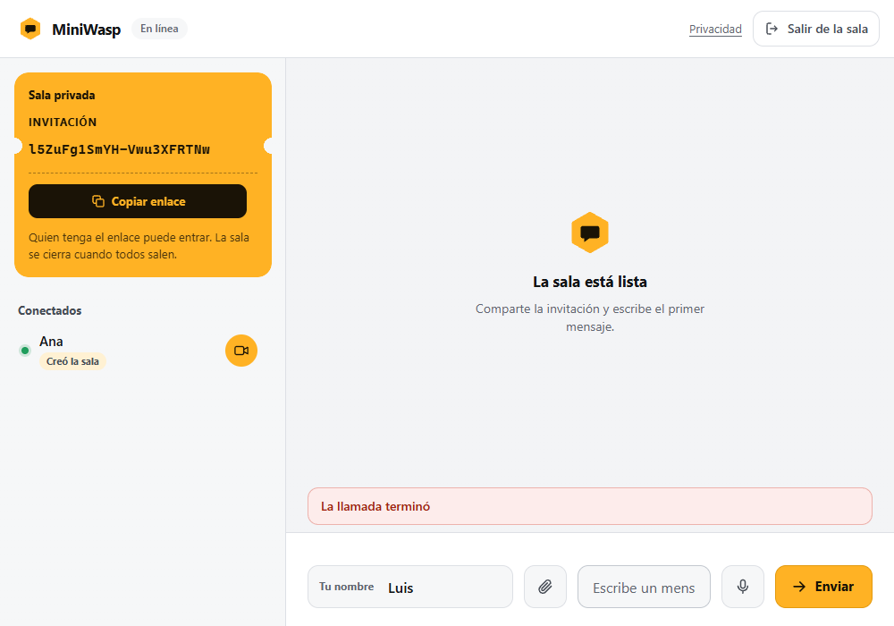

### E2E-07 - Permiso de camara negado: aviso y ninguna invitacion enviada (Sad) - **PASS**

**Pasos**

1. Abrir un tercer Chrome (Carla) sin --use-fake-ui-for-media-stream y sin conceder camera/microphone al contexto
2. Entrar a la sala con el enlace de invitacion vigente y escribir el nombre
3. Carla pulsa "Videollamar" junto a Ana
4. Esperar 1500 ms y revisar los eventos WebSocket enviados por Carla y recibidos por Ana

**Esperado:** Carla ve "Permite el acceso a la cámara y al micrófono para hacer videollamadas", getUserMedia falla con NotAllowedError, no se envia call-invite y Ana no recibe ninguna llamada.

**Observado:** Carla ve "Permite el acceso a la cámara y al micrófono para hacer videollamadas"; getUserMedia -> NotAllowedError; call-invite enviados: 0; Ana recibio call-incoming: false.

**Verificaciones**

- [x] getUserMedia falla con NotAllowedError
- [x] No se envia call-invite
- [x] Ana no recibe la llamada
- [x] El panel de llamada de Carla se cierra

- Errores de consola esperados: 0
- Errores de consola NO esperados: 0

**Metricas**

```json
{
  "mediaRequest": {
    "ok": false,
    "errorName": "NotAllowedError",
    "t": 1795234768650
  },
  "invitesSent": 0
}
```

**Evidencia**

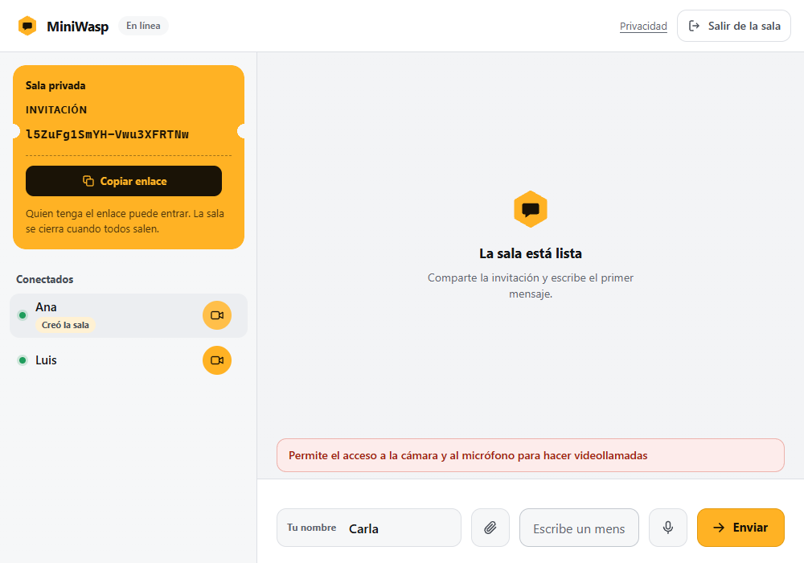

### E2E-08 - Rechazar una llamada entrante (Sad) - **PASS**

**Pasos**

1. Ana llama a Luis
2. Luis ve "Videollamada entrante" y pulsa "Rechazar"
3. Revisar paneles, avisos y la camara de Ana

**Esperado:** Ambos paneles se cierran, Ana ve "La persona rechazó la llamada", recibe call-ended con reason=rejected y su camara queda liberada.

**Observado:** Ana ve "La persona rechazó la llamada", call-ended reason=rejected; pistas de Ana: ended,ended,ended,ended.

**Verificaciones**

- [x] Panel de Luis cerrado
- [x] Ana ve el aviso de rechazo
- [x] call-ended con reason=rejected
- [x] Camara de Ana liberada

- Errores de consola esperados: 0
- Errores de consola NO esperados: 0

**Metricas**

```json
{
  "callEnded": {
    "type": "call-ended",
    "callId": "5a6d5d62-4cdc-41cf-81d7-3e8f65fa6bb0",
    "reason": "rejected",
    "t": 1795234770487
  },
  "releaseAna": {
    "tracks": [
      {
        "kind": "audio",
        "enabled": true,
        "readyState": "ended"
      },
      {
        "kind": "video",
        "enabled": true,
        "readyState": "ended"
      },
      {
        "kind": "audio",
        "enabled": true,
        "readyState": "ended"
      },
      {
        "kind": "video",
        "enabled": true,
        "readyState": "ended"
      }
    ],
    "peerStates": [
      "closed"
    ]
  }
}
```

**Evidencia**

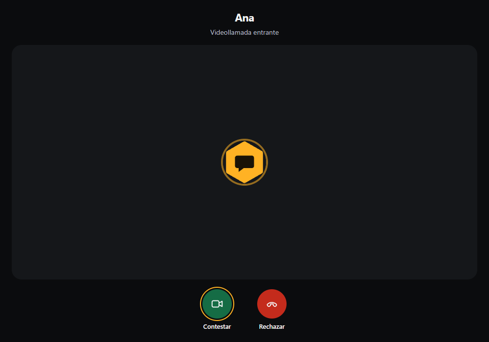
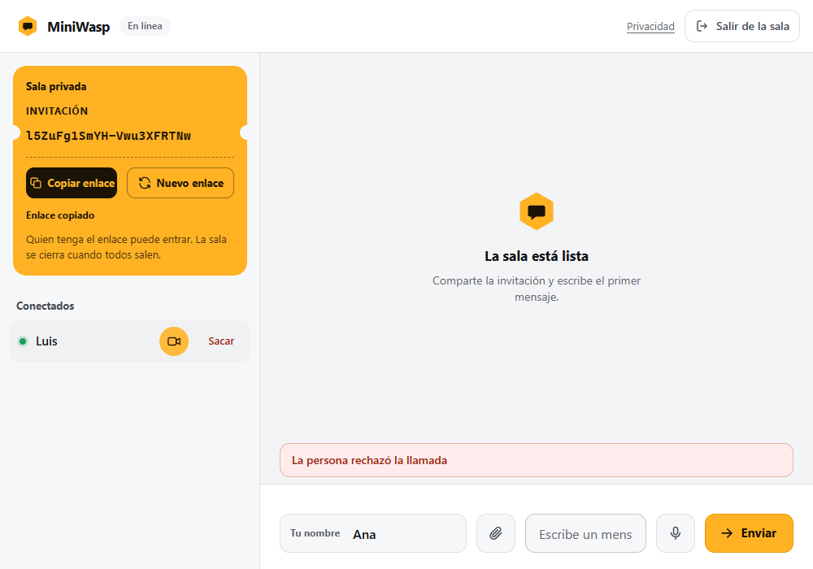

### E2E-09 - La persona que llama cancela mientras suena (Sad) - **PASS**

**Pasos**

1. Ana llama a Luis
2. Con Ana en "Llamando…" y Luis en "Videollamada entrante", Ana pulsa "Colgar"
3. Revisar el panel de Luis y /metrics

**Esperado:** El panel de Luis se cierra con "La llamada terminó", la camara de Ana se libera y callsActive=0.

**Observado:** Ana estaba en "Llamando…"; Luis ve "La llamada terminó"; pistas de Ana liberadas; callsActive=0.

**Verificaciones**

- [x] Ana estaba en "Llamando…"
- [x] Luis ve el aviso de fin
- [x] Camara de Ana liberada
- [x] callsActive vuelve a 0

- Errores de consola esperados: 0
- Errores de consola NO esperados: 0

**Metricas**

```json
{
  "releaseAna": {
    "tracks": [
      {
        "kind": "audio",
        "enabled": true,
        "readyState": "ended"
      },
      {
        "kind": "video",
        "enabled": true,
        "readyState": "ended"
      },
      {
        "kind": "audio",
        "enabled": true,
        "readyState": "ended"
      },
      {
        "kind": "video",
        "enabled": true,
        "readyState": "ended"
      },
      {
        "kind": "audio",
        "enabled": true,
        "readyState": "ended"
      },
      {
        "kind": "video",
        "enabled": true,
        "readyState": "ended"
      }
    ],
    "peerStates": [
      "closed"
    ]
  }
}
```

**Evidencia**

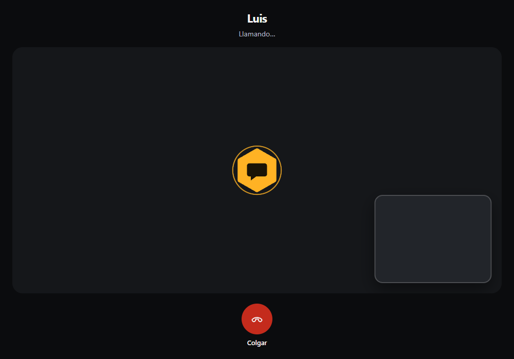
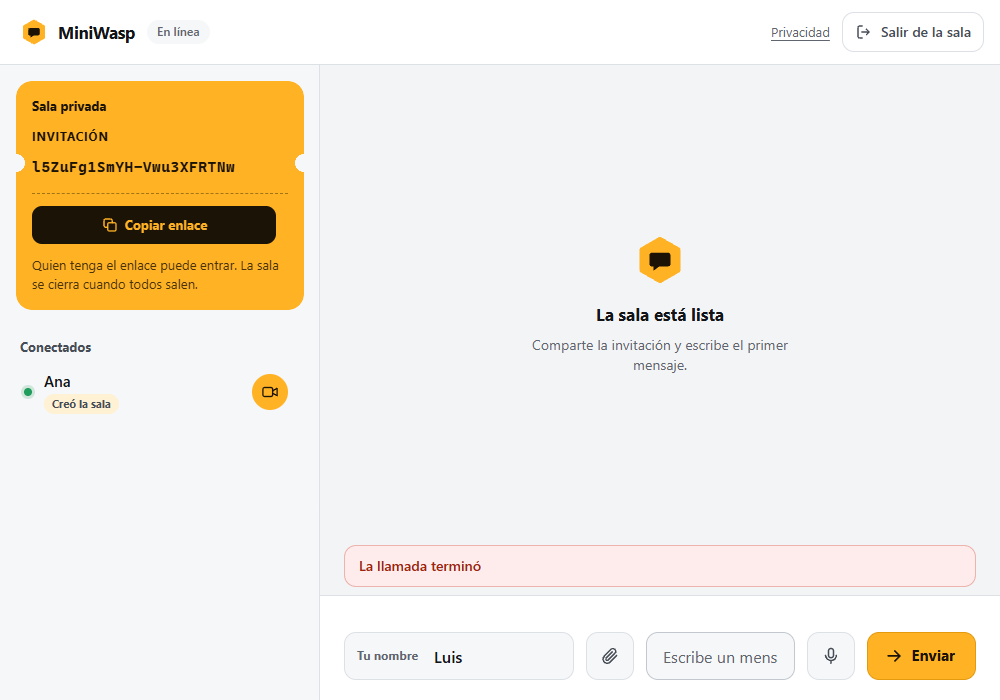

### E2E-11 - Ambos cuelgan al mismo tiempo (Concurrency) - **PASS**

**Pasos**

1. Establecer una llamada Ana-Luis
2. Programar en ambos navegadores un clic en "Colgar" a la misma hora (ahora + 300 ms)
3. Revisar paneles, consola, recursos, /metrics y registro del servidor

**Esperado:** Ambos paneles se cierran, no hay errores de consola ni del servidor, todo se libera y callsActive=0.

**Observado:** Clics separados por 0 ms; call-hangup enviados Ana=1, Luis=1; ambos paneles cerrados; recursos liberados; callsActive=0; errores del servidor: 0.

**Verificaciones**

- [x] Ambos navegadores enviaron call-hangup (la carrera ocurrio de verdad)
- [x] Recursos liberados en ambos lados
- [x] callsActive vuelve a 0
- [x] Sin errores en el registro del servidor

- Errores de consola esperados: 0
- Errores de consola NO esperados: 0

**Metricas**

```json
{
  "clickSkewMs": 0,
  "hangUpsSent": {
    "ana": 1,
    "luis": 1
  }
}
```

**Evidencia**

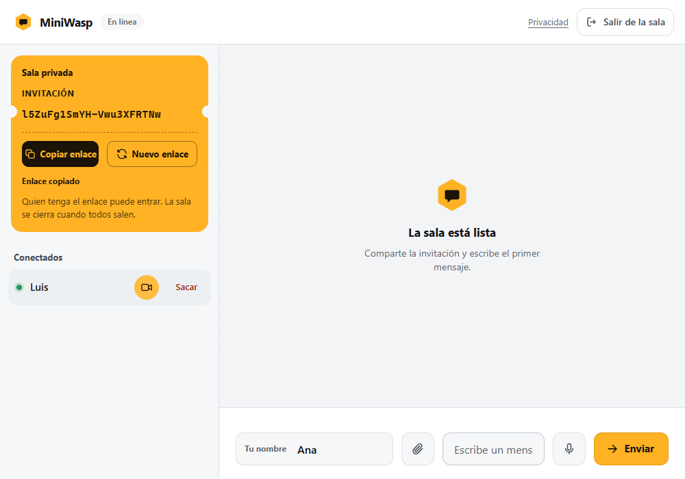

### E2E-15 - Corte breve del chat durante la llamada: aviso de reconexion y la llamada sigue (Recovery) - **PASS**

**Pasos**

1. Ana llama a Luis, Luis contesta y ambos ven el video del otro
2. Se cierra el WebSocket de Luis sin que la app lo pida (corte de red simulado)
3. Luis ve el aviso "Reconectando…" con el indicador de carga sobre el video
4. El chat de Luis reconecta solo y envia call-resume; el aviso desaparece
5. Esperar hasta 22 s despues del corte (mas que la espera del servidor)
6. Verificar que ambos siguen "En llamada" y que el video avanza en los dos sentidos

**Esperado:** El aviso de reconexion aparece y se va solo; Luis envia call-resume; pasada la espera del servidor la llamada sigue activa en ambos lados y el video remoto avanza.

**Observado:** Corte simulado del WebSocket de Luis; aviso "Reconectando…" visible y luego oculto; call-resume enviado 1 vez; a los 22 s ambos siguen en llamada con video avanzando.

**Verificaciones**

- [x] Se cerro el WebSocket de Luis
- [x] Luis pide retomar la llamada una vez al reconectar
- [x] Ana sigue en llamada
- [x] Luis sigue en llamada
- [x] El video avanza en los dos sentidos

- Errores de consola esperados: 0
- Errores de consola NO esperados: 0

**Metricas**

```json
{}
```

**Evidencia**

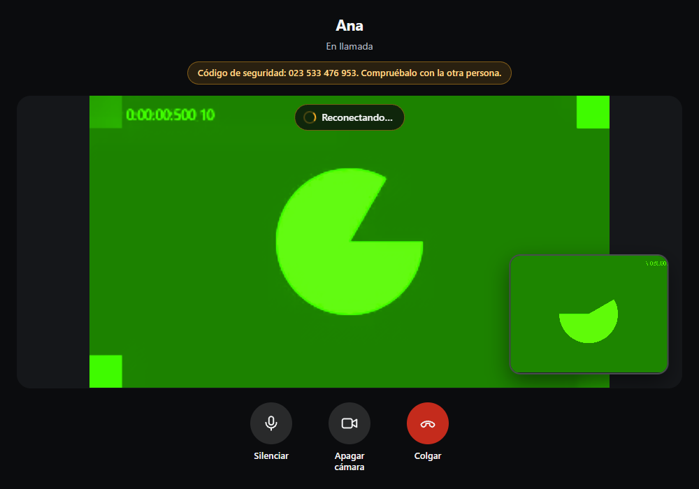
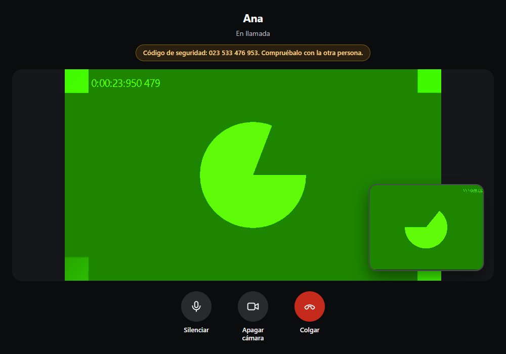

### E2E-13 - Renovar la invitacion invalida el enlace anterior (Security) - **PASS**

**Pasos**

1. Luis (no es dueno) no ve "Nuevo enlace"; su cliente envia a mano {type:"room-rotate-invite"} por el WebSocket
2. Ana pulsa "Nuevo enlace"
3. Verificar que Ana y Luis ven la nueva invitacion
4. Un cuarto Chrome (Diego) abre el enlace anterior y luego el nuevo; despues pulsa "Salir de la sala"

**Esperado:** El intento de Luis se rechaza con "Solo quien creó la sala puede hacer esto" y la invitacion no cambia; tras el clic de Ana ambos ven otra invitacion; el enlace anterior da 404 y "La sala no existe o el enlace ya no es válido"; el nuevo permite entrar.

**Observado:** Renovacion enviada a mano por Luis -> "Solo quien creó la sala puede hacer esto", invitacion sin cambios. Tras "Nuevo enlace" ambos ven otra invitacion; enlace anterior -> POST /rooms/join 404; con el nuevo Diego entro y salio.

**Verificaciones**

- [x] Luis no ve "Nuevo enlace"
- [x] El servidor ignora la renovacion pedida por quien no es dueno
- [x] Ana y Luis ven la nueva invitacion
- [x] El enlace anterior responde 404
- [x] El enlace nuevo permite entrar

- Errores de consola esperados: 0
- Errores de consola NO esperados: 0

**Metricas**

```json
{
  "forgedRotationByNonOwner": {
    "isRotateHidden": true,
    "wasSent": true,
    "tokenAfterForgery": "l5ZuFg1SmYH-Vwu3XFRTNw",
    "unchanged": true
  },
  "oldLinkJoinStatus": 404
}
```

**Evidencia**

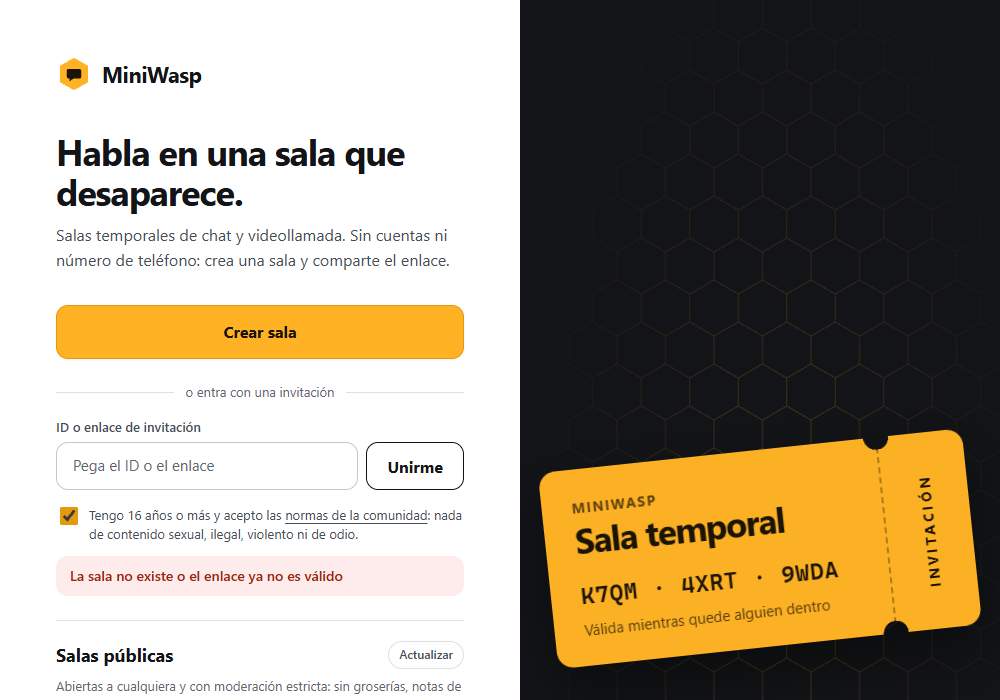

### E2E-14 - Sacar a una persona: no puede volver con el enlace viejo, si con el nuevo (Security) - **PASS**

**Pasos**

1. Ana pulsa "Sacar" junto a Luis
2. Verificar en Luis: cierre del WebSocket con codigo 4403, pantalla de inicio con el aviso y GET /session 401
3. Verificar en Ana: Luis desaparece de la lista y la invitacion se renueva
4. Luis abre el enlace anterior
5. Luis abre el enlace nuevo y vuelve a escribir su nombre

**Esperado:** Luis vuelve al inicio con "Ya no estás en la sala: saliste, te sacaron o la sala se cerró." (cierre 4403, sesion revocada); la invitacion cambia; el enlace viejo da 404 y "La sala no existe o el enlace ya no es válido"; con el nuevo Luis entra otra vez y Ana lo ve.

**Observado:** Luis: cierre 4000,4403, aviso "Ya no estás en la sala: saliste, te sacaron o la sala se cerró.", GET /session 401. Invitacion renovada. Enlace viejo -> 404; con el nuevo Luis volvio a la sala y Ana lo ve.

**Verificaciones**

- [x] El WebSocket de Luis se cierra con 4403
- [x] La sesion de Luis queda revocada (GET /session 401)
- [x] La invitacion se renueva al sacar a alguien
- [x] El enlace viejo ya no sirve (404)

- Errores de consola esperados: 3
  - luis (console:pestana-1): `Failed to load resource: the server responded with a status of 401 (Unauthorized)`
  - luis (console:pestana-1): `Failed to load resource: the server responded with a status of 401 (Unauthorized)`
  - luis (console:pestana-1): `Failed to load resource: the server responded with a status of 404 (Not Found)`
- Errores de consola NO esperados: 0

**Metricas**

```json
{
  "closeCodesLuis": [
    4000,
    4403
  ],
  "sessionAfterExpulsion": {
    "status": 401,
    "body": null
  },
  "oldLinkJoinStatus": 404
}
```

**Evidencia**

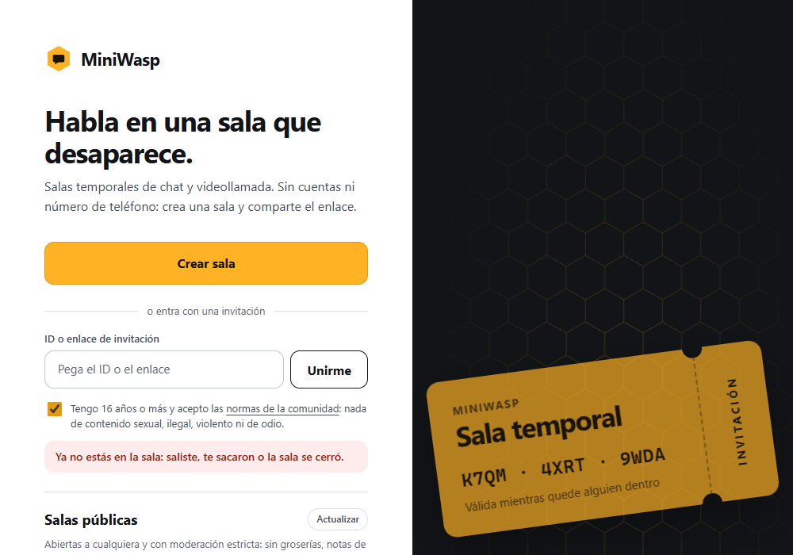
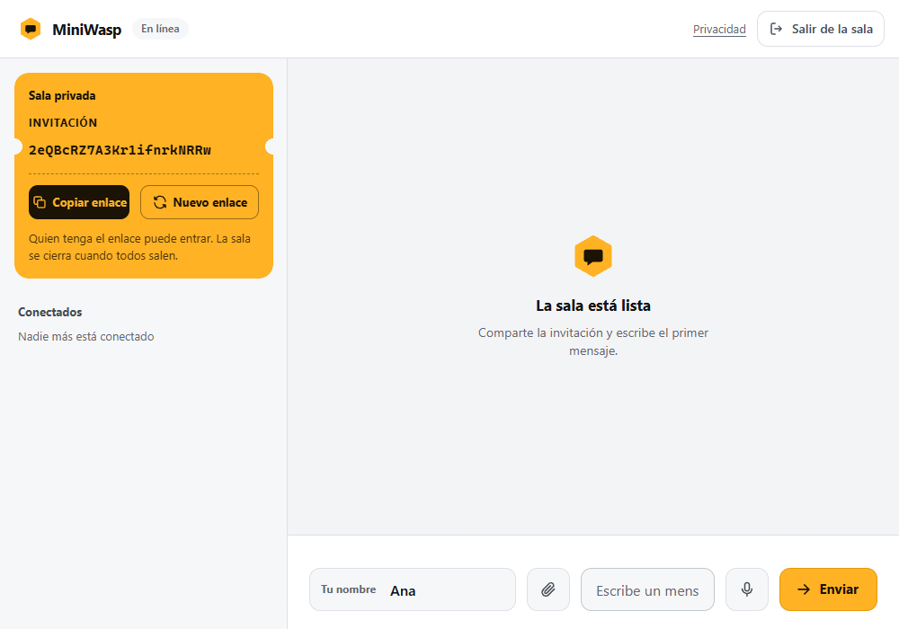

### E2E-10 - Reinicio del servidor de senalizacion sin llamada activa (Recovery) - **PASS**

**Pasos**

1. Con Ana y Luis en la sala y sin llamada, matar el proceso del servidor
2. Verificar que el chat muestra "Reconectando…"
3. Arrancar de nuevo el servidor en el mismo puerto (salas y sesiones viven en memoria y se pierden)
4. Esperar a que el cliente reintente y vuelva al inicio con el aviso
5. Ana crea una sala nueva y Luis entra con el enlace nuevo; esperar "En línea" y la lista de conectados

**Esperado:** "Reconectando…" al caer el servidor; tras el reinicio, pantalla de inicio con "Ya no estás en la sala: saliste, te sacaron o la sala se cerró." en ambos; en una sala nueva, "En línea" y ambos se ven otra vez.

**Observado:** Secuencia en Ana: 4ms status=Reconectando… | 2026ms status=Reconectando… | 2036ms home-error=Ya no estás en la sala: saliste, te sacaron o la sala se cerró. | 2036ms home=visible | 2036ms chat=oculto | 2484ms home-error=oculto | 2490ms home=oculto | 2490ms chat=visible | 2496ms status=En línea. Servidor caido 565 ms; inicio visible 1453 ms despues del reinicio; "En línea" 41 ms despues de crear la sala nueva.

**Verificaciones**

- [x] Se mostro "Reconectando…"
- [x] Se volvio al inicio tras el reinicio
- [x] En la sala nueva se muestra "En línea"

- Errores de consola esperados: 6
  - ana (console:pestana-1): `Failed to load resource: net::ERR_CONNECTION_REFUSED`
  - ana (console:pestana-1): `WebSocket connection to 'wss://localhost:60281/' failed: HTTP Authentication failed; no valid credentials available`
  - ana (console:pestana-1): `Failed to load resource: the server responded with a status of 401 (Unauthorized)`
  - luis (console:pestana-1): `Failed to load resource: net::ERR_CONNECTION_REFUSED`
  - luis (console:pestana-1): `WebSocket connection to 'wss://localhost:60281/' failed: HTTP Authentication failed; no valid credentials available`
  - luis (console:pestana-1): `Failed to load resource: the server responded with a status of 401 (Unauthorized)`
- Errores de consola NO esperados: 0

**Metricas**

```json
{
  "uiSequenceAna": [
    {
      "atMs": 4,
      "element": "status",
      "shown": "Reconectando…"
    },
    {
      "atMs": 2026,
      "element": "status",
      "shown": "Reconectando…"
    },
    {
      "atMs": 2036,
      "element": "home-error",
      "shown": "Ya no estás en la sala: saliste, te sacaron o la sala se cerró."
    },
    {
      "atMs": 2036,
      "element": "home",
      "shown": "visible"
    },
    {
      "atMs": 2036,
      "element": "chat",
      "shown": "oculto"
    },
    {
      "atMs": 2484,
      "element": "home-error",
      "shown": "oculto"
    },
    {
      "atMs": 2490,
      "element": "home",
      "shown": "oculto"
    },
    {
      "atMs": 2490,
      "element": "chat",
      "shown": "visible"
    },
    {
      "atMs": 2496,
      "element": "status",
      "shown": "En línea"
    }
  ],
  "killToReconnectingMs": 2008,
  "serverDowntimeMs": 565,
  "restartToHomeShownMs": 1453,
  "newRoomToOnlineMs": 41
}
```

**Evidencia**

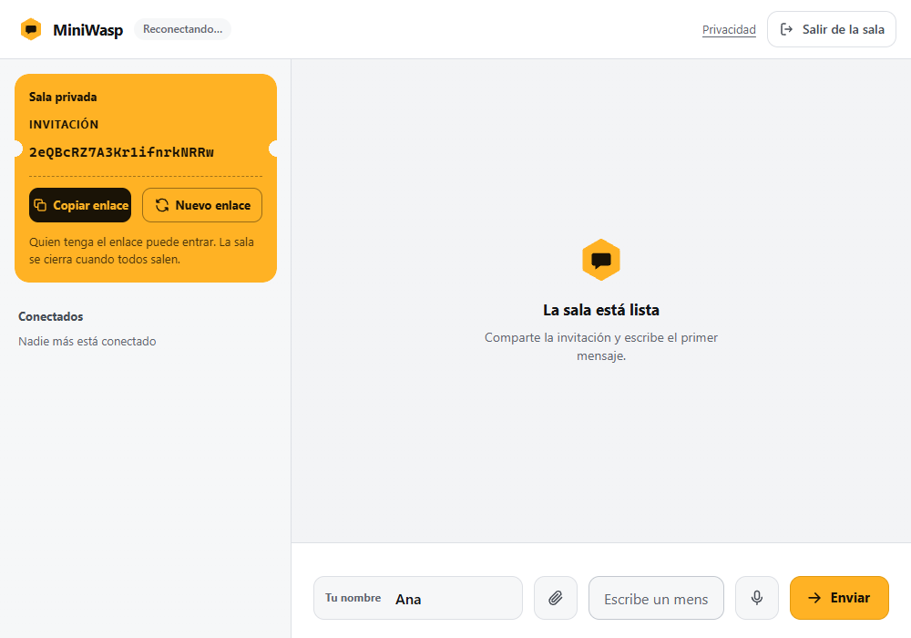
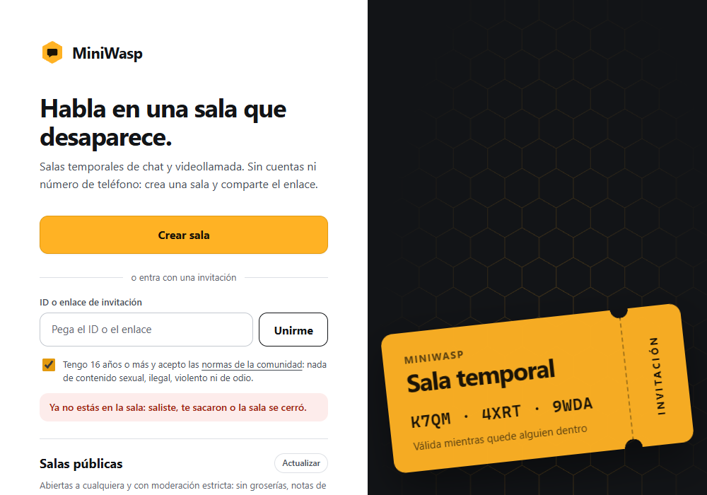
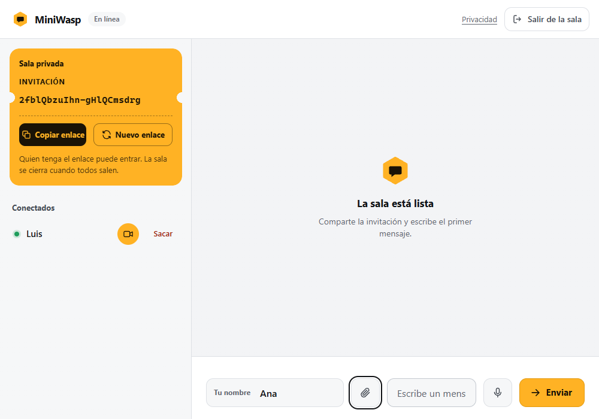

### E2E-12 - Cerrar sesion durante la llamada termina la llamada del otro participante (Security) - **PASS**

**Pasos**

1. Establecer una llamada Ana-Luis
2. Comprobar si el boton "Salir de la sala" de la pestana en llamada es clicable (el panel de llamada lo cubre)
3. Ana abre una segunda pestana con la misma sesion y pulsa "Salir de la sala" (DELETE /session)
4. Revisar el panel y el aviso de Luis, la pantalla de la pestana en llamada de Ana y los recursos de ambos

**Esperado:** El servidor revoca la sesion y cierra sus conexiones: Luis ve el panel cerrado con "Se perdió la conexión de la llamada"; la pestana de Ana vuelve a #home con "Ya no estás en la sala: saliste, te sacaron o la sala se cerró."; todo se libera.

**Observado:** "Salir de la sala" clicable durante la llamada en la misma pestana: false. Tras salir desde otra pestana, Luis ve "Se perdió la conexión de la llamada"; Ana ve "Ya no estás en la sala: saliste, te sacaron o la sala se cerró."; recursos liberados; callsActive=0.

**Verificaciones**

- [x] Luis ve que la llamada se corto
- [x] Recursos liberados en ambos lados
- [x] callsActive vuelve a 0

- Errores de consola esperados: 1
  - ana (console:pestana-1): `Failed to load resource: the server responded with a status of 401 (Unauthorized)`
- Errores de consola NO esperados: 0

**Metricas**

```json
{
  "logoutButtonReachableDuringCall": false
}
```

**Evidencia**

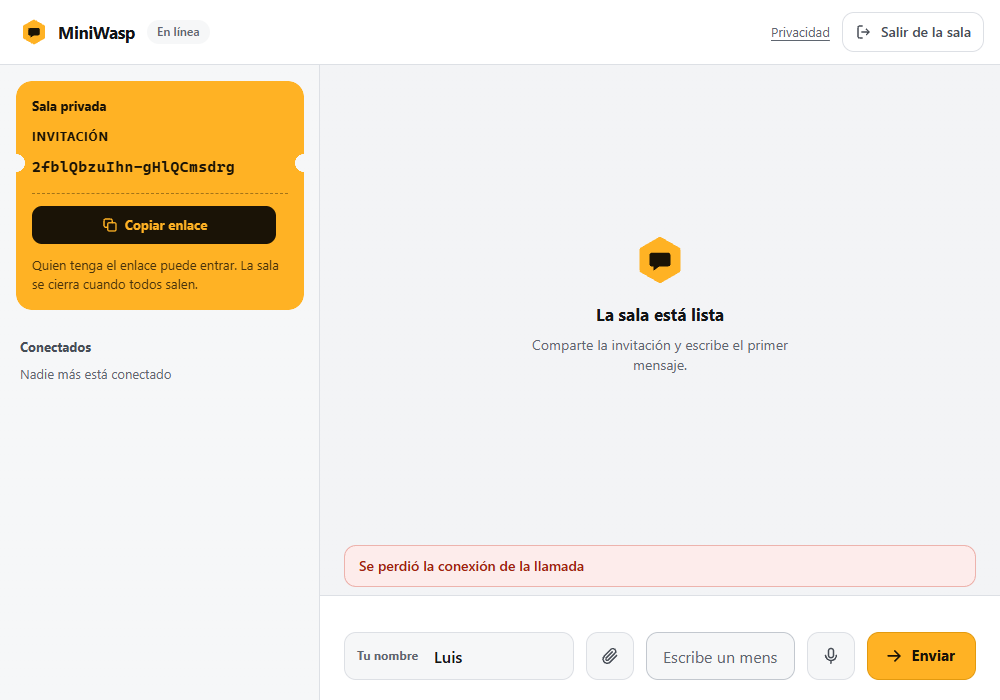
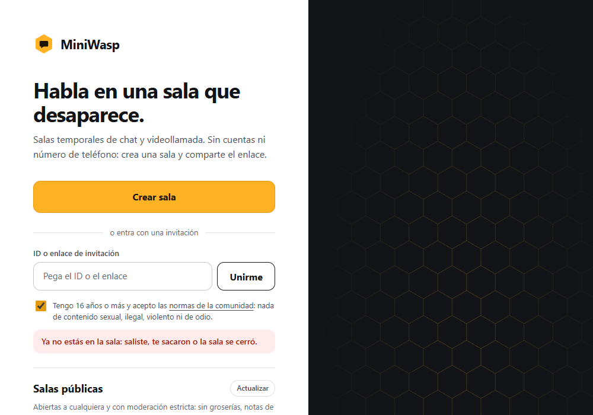
