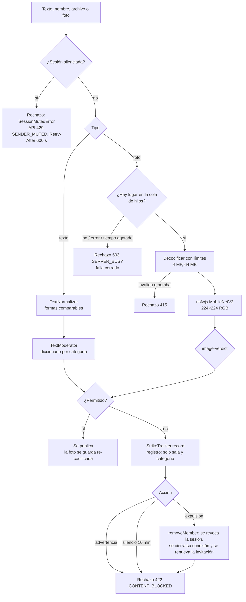

# Moderación de contenido

MiniWasp no tiene cuentas ni base de datos, pero sí publica texto, fotos, notas de voz y archivos
entre personas que no siempre se conocen. Este documento describe qué contenido se bloquea, cómo se
decide, qué pasa con quien insiste y qué límites tiene la moderación automática. Las normas que ve
la persona usuaria están en `src/client/rules.html` (`/rules.html`).

## Política

- **Edad mínima: 16 años.** Para crear una sala, entrar a una o iniciar sesión en la API hay que
  aceptar las normas: el cuerpo de la petición debe llevar `acceptedRules: true` (exactamente
  `true`; un texto o un `1` no cuentan). Sin eso la respuesta es `400 RULES_NOT_ACCEPTED`
  (`src/server/http/community-rules.js`, usado en `room-endpoint.js` y `api/auth-endpoint.js`). El
  navegador recuerda la casilla en `localStorage` (`miniwasp-rules-accepted`).
- **Se bloquea antes de publicar.** Todo pasa por `ContentGate` (`src/server/moderation/content-gate.js`)
  antes de llegar a la sala. Si se bloquea, no se publica ni se guarda.
- **La grosería común está permitida en las salas privadas.** Es una decisión de producto: entre
  personas que se invitaron, palabras como "mierda" o "fuck" se publican. En las salas públicas y en
  los susurros, donde conversan desconocidos, el perfil estricto también bloquea groserías e insultos
  (ver *Perfiles*).
- **Todo es local.** El diccionario y el modelo de imágenes corren dentro del proceso; ningún
  contenido se envía a servicios de terceros.

## Perfiles: estándar y estricto

Cada sala lleva un `ModerationProfile` (`src/server/moderation/moderation-profile.js`) que reúne
todo lo que cambia entre una sala privada y una pública, para que ninguna otra pieza tenga que
preguntar de qué tipo es la sala. El tipo de sala elige el perfil en `ROOM_KINDS`
(`src/server/rooms/room.js`).

| Regla | `STANDARD` (salas privadas por invitación) | `STRICT` (salas públicas y susurros) |
|---|---|---|
| Texto | Solo contenido grave (las categorías de abajo) | Lo grave **y además groserías e insultos** (`PROFANITY`, `INSULT`) |
| Fotos: umbral explícito (`Porn` + `Hentai`) | ≥ 0,70 | ≥ 0,50 |
| Fotos: umbral sugerente (`Sexy`) | ≥ 0,90 | ≥ 0,60 |
| Tipos de archivo | JPEG, notas de voz (WebM, Ogg, M4A), PDF y texto plano | **Solo `image/jpeg` y `text/plain`**: lo que la moderación puede revisar por dentro (415 `FILE_TYPE_NOT_ALLOWED` para lo demás) |
| Bloqueos para silenciar | 3 | 2 |
| Reportes para borrar un mensaje | 3 | 2 |
| Modo lento | Sin modo lento | 2 s entre mensajes de una misma sesión (`SlowMode`, `src/server/messaging/slow-mode.js`) |
| Al expulsar | Se renueva la invitación | Se renueva la invitación **y se veta** la huella HMAC de la IP (`RoomBanList`) mientras exista la sala |
| Título de la sala | No tiene | En las públicas, obligatorio (hasta 40 caracteres, sin caracteres invisibles) y moderado con este perfil al crearla; los susurros no tienen |
| Nombre al iniciar sesión en la API | Moderado con este perfil | Moderado con este perfil |

El turno del modo lento se registra solo cuando el mensaje ya pasó la moderación: un mensaje
bloqueado no consume el turno. El modo lento responde `INVALID_INPUT` (400 en la API) con el aviso
"Esta sala tiene modo lento".

## Categorías

| Categoría | Qué cubre | Motivo que ve la persona ("No se envió: …") | Consecuencia |
|---|---|---|---|
| `MINORS_SEXUAL` | Contenido sexual que involucra a menores: términos directos, o una referencia a un menor (incluida una edad menor de 18) junto a un término sexual | parece contener contenido sexual que involucra a menores | **Expulsión inmediata** |
| `SEXUAL_EXPLICIT` | Contenido sexual explícito en texto o fotos | parece contener contenido sexual explícito | Falta |
| `VIOLENT_THREAT` | Amenazas de violencia contra personas | parece contener una amenaza violenta | Falta |
| `HATE` | Discurso de odio por origen, religión, género, orientación o discapacidad | parece contener discurso de odio | Falta |
| `WEAPON_SALES` | Una intención de venta junto a un arma | parece ofrecer la venta de armas | Falta |
| `DRUG_SALES` | Una intención de venta junto a una droga | parece ofrecer la venta de drogas | Falta |
| `INSULT` | Insultos dirigidos ("eres un idiota", "you are a loser"). **Solo perfil estricto** | parece contener insultos | Falta |
| `PROFANITY` | Groserías comunes ("mierda", "chucha", "fuck"). **Solo perfil estricto** | parece contener groserías | Falta |

Las reglas de menores se evalúan siempre primero (`TextModerator`), sin importar el orden en que
estén definidas, y las del nivel estricto siempre después de las graves. El diccionario cubre español latinoamericano/ecuatoriano e inglés.

## Qué se revisa

| Contenido | Dónde | Revisión |
|---|---|---|
| Mensaje de chat y pie de foto | `RoomMessenger.send` (WebSocket y API) | Texto |
| Nombre visible | Al cambiarlo (`routes.js`), en cada mensaje y al iniciar sesión en la API (con el perfil de la sala de destino) | Texto |
| Título de sala pública | Al crearla (`room-endpoint.js` y `api/api-room-resolver.js`) | Texto, siempre con el perfil estricto |
| Nombre de archivo | `AttachmentUploader` | Texto (tras sanear el nombre) |
| Archivo `.txt` | `AttachmentUploader` | Texto completo |
| Foto (JPEG) | `AttachmentUploader` → `ImageInspector` | Modelo de imágenes y re-codificación |
| Nota de voz, PDF | — | **No se analizan por dentro** (ver riesgos residuales); por eso las salas públicas y los susurros no los aceptan |

El nombre de la API y el título de una sala pública se revisan con `reviewWithoutSession`: se
bloquean, pero no suman faltas porque aún no hay sesión a la que asignarlas.

## Flujo

## Normalización del texto

`src/server/moderation/text-normalizer.js` reduce el texto a formas comparables para que las
evasiones típicas no escondan un término:

| Paso | Ejemplo de evasión que neutraliza |
|---|---|
| Minúsculas, NFKD y eliminación de tildes (la `ñ` se conserva para no confundir "niña" con "Nina") | `PÓRNO` |
| Eliminación de caracteres de formato invisibles (`\p{Cf}`: ancho cero, marcas de dirección) | `por​no` con un espacio de ancho cero |
| Leetspeak (`4→a`, `3→e`, `1→i`, `0→o`, `5→s`, `7→t`, `@→a`, `$→s`), solo en palabras que mezclan letras y símbolos; los números puros se respetan para poder leer edades | `p0rn0` |
| Letras repetidas tres o más veces se reducen a una (las dobles se respetan) | `pooorno` |
| Palabras deletreadas letra a letra (3 o más) se recomponen | `p o r n o`, `p.o.r.n.o` |
| Forma "compacta" (solo letras, todo junto), comparada **solo** con términos largos e inequívocos | `p-o-r-n-o-g-r-a-f-i-a` |
| Frases exentas retiradas antes de comparar | "matar de risa", "matar el tiempo" |

Además del diccionario por palabra, frase y prefijo (`pornograf*`), algunas reglas exigen
**coocurrencia**: "coca" o "pistola" solos no bloquean; junto a "vendo" o "a domicilio" sí. Una edad
menor de 18 (`tengo 15`) solo cuenta como menor si aparece junto a un término sexual.

El moderador es puro y determinista: el mismo texto siempre recibe la misma decisión.

## Imágenes

1. **En el navegador** (`src/client/attachments/image-preparer.js`): la foto se dibuja en un lienzo,
   se reduce a 1600 px de lado como máximo y se convierte a JPEG (calidad 0,85). Así se pierden los
   metadatos (incluido el GPS de la cámara) antes de salir del dispositivo.
2. **En el servidor**, dentro de un hilo de `worker_threads` (`image-worker.js`, `WorkerPool`):
   - Se decodifica con `jpeg-js` con límites de 4 megapíxeles y 64 MB de memoria
     (`image-sanitizer.js`). Una imagen dañada o una bomba de descompresión se rechaza con 415.
   - Se reduce a 224×224 RGB promediando bloques y se clasifica con **nsfwjs (MobileNetV2)** sobre
     TensorFlow.js con backend **WASM**. El modelo viene empaquetado; ninguna imagen sale del servidor.
   - Si se permite, se **re-codifica desde los píxeles** (calidad 85). El archivo guardado no conserva
     EXIF, GPS ni contenido extra escondido (archivos políglotas).

Umbrales (`src/server/moderation/image-verdict.js`):

| Señal | Umbral | Motivo |
|---|---|---|
| `Porn` + `Hentai` | ≥ 0,70 | Lo explícito se bloquea con certeza moderada |
| `Sexy` | ≥ 0,90 | Lo sugerente solo con certeza muy alta, para no bloquear fotos comunes (una playa) |

Las clases `Neutral` y `Drawing` nunca bloquean. Toda imagen bloqueada se clasifica como
`SEXUAL_EXPLICIT`: el modelo no distingue edades, así que una imagen no puede activar la expulsión
inmediata por menores.

**Falla cerrado.** Los hilos arrancan con la primera foto; por defecto son
`min(max(núcleos − 1, 1), 4)` (configurable con `IMAGE_MODERATION_WORKERS`) y cada uno carga su propia
copia del modelo (unos 150 MB según el comentario de `image-inspector.js`). La cola admite 100 tareas
y cada tarea tiene 10 s. Si la cola está llena, la tarea tarda demasiado, el hilo falla o el modelo
no carga, la foto se rechaza con `503 SERVER_BUSY`: nunca se publica una foto sin revisar.

## Faltas, silencio y expulsión

`src/server/moderation/strike-tracker.js` cuenta los bloqueos por sesión en una ventana deslizante:

| Situación | Acción |
|---|---|
| 1.º y 2.º bloqueo dentro de 15 min | Advertencia: el mensaje se rechaza con su motivo |
| 3.º bloqueo dentro de 15 min | **Silencio de 10 min**: la sesión no puede publicar nada (texto, nombre, archivos) |
| Volver a llegar a 3 bloqueos dentro de los 15 min siguientes al silencio anterior | **Expulsión** de la sala |
| Cualquier contenido `MINORS_SEXUAL` | **Expulsión inmediata**, a la primera |

Con el perfil estricto el umbral baja de 3 a 2 bloqueos: el segundo silencia y volver a llegar a 2
tras el silencio expulsa.

La expulsión usa la misma ruta que cuando quien creó la sala saca a alguien
(`src/server/rooms/room-membership.js` › `removeMember`): se revoca la sesión, se libera su nombre,
se la saca de las videollamadas, se cierran sus conexiones y **se renueva la invitación**, para que el
enlace que ya tenía no le sirva para volver. En las salas públicas (perfil con `bansExpelled`)
`removeMember` además guarda en `RoomBanList` la huella seudónima de su IP (HMAC, la misma que
llevan los registros; nunca la IP): entrar otra vez, por la lista, por invitación o por la API,
responde 403 `BANNED_FROM_ROOM`. El veto vive lo mismo que la sala y tiene un tope de 500 huellas.
El historial de faltas se olvida al revocarse la sesión y
las sesiones inactivas se podan (como mucho una vez por minuto) para acotar la memoria.

## Borrar y reportar mensajes

`src/server/messaging/room-messenger.js`, compartido por el WebSocket y la API REST:

- **Borrar para todos:** puede hacerlo quien envió el mensaje o quien creó la sala. Cualquier otra
  persona recibe un error (`403 NOT_MESSAGE_AUTHOR` en la API). Borrar un mensaje con adjunto borra
  también el archivo.
- **Reportar:** quien creó la sala recibe el aviso `message-reported` y puede borrarlo o sacar a la
  persona. Cada sesión cuenta una sola vez; reportar un mensaje propio no tiene efecto.
- **Borrado automático:** con **3 reportes de sesiones distintas** (2 en las salas públicas y los
  susurros) el mensaje se borra solo, para que la sala no dependa de que quien la creó esté conectada.
- Los reportes tienen su propio límite: 10 por minuto por IP (`server-settings.js`).

Eventos del protocolo (`src/shared/events.js`): `message-delete`, `message-report` (cliente) y
`message-deleted`, `message-reported` (servidor). En la API: `DELETE /api/v1/messages/{id}` y
`POST /api/v1/messages/{id}/report` (ver [api/README.md](api/README.md)).

## Privacidad de la moderación

- El contenido bloqueado **no se guarda ni se registra**. Los eventos `moderation.blocked` y
  `moderation.expelled` solo llevan el id de la sala y la categoría.
- La métrica `contentBlocked` cuenta bloqueos sin ningún dato del contenido.
- Las fotos y los textos se analizan en memoria dentro del proceso; no hay servicios externos.
- Los reportes registran (`message.reported`) solo la sala y el número de reportes, no quién reportó.

## Falsos positivos y falsos negativos

| Tipo | Ejemplos y mitigación |
|---|---|
| Falso positivo de texto | El problema de Scunthorpe se evita comparando por palabra completa y usando la forma compacta solo con términos largos e inequívocos. Los modismos ("matar de risa") y los objetos que comparten palabra ("pistola de agua") están exentos. Una droga o un arma sin intención de venta no se bloquea. |
| Falso positivo de imagen | El umbral de 0,90 para `Sexy` deja pasar fotos de playa o deporte. Si una foto legítima se bloquea, la persona ve el motivo y puede enviar otra; cuenta como falta. |
| Falso negativo de texto | Sinónimos, jerga nueva, idiomas no cubiertos, eufemismos o texto dentro de una imagen no se detectan. |
| Falso negativo de imagen | El modelo es pequeño (MobileNetV2) y puede fallar con encuadres o ilustraciones inusuales. |

Las pruebas `text-moderator.test.js` ("falsos positivos que deben pasar") e `image-moderation.test.js`
fijan estos comportamientos.

## Riesgos residuales

- **Las notas de voz y los PDF no se analizan por dentro.** Solo se verifica su tipo por contenido,
  su tamaño y su nombre. Los PDF siempre se descargan (`Content-Disposition: attachment`) y nunca se
  abren dentro del origen de MiniWasp.
- **Los filtros de palabras se pueden evadir** con creatividad suficiente; la normalización solo sube
  el costo de la evasión.
- **No hay coincidencia con hashes de material de abuso sexual infantil (PhotoDNA o similares).**
  Esos servicios exigen acuerdos con organizaciones especializadas que este proyecto no tiene. El
  modelo local detecta desnudez, no edades ni material conocido.
- **No hay revisión humana** ni equipo de moderación: la última línea de defensa es quien creó la
  sala, los reportes y el borrado automático.
- **Sin cuentas, una persona expulsada de una sala privada puede volver** si alguien de la sala le
  comparte la nueva invitación (la anterior se renueva al expulsarla).
- **El veto de las salas públicas es por IP.** Quien cambia de red (datos móviles, VPN, otra conexión)
  obtiene otra huella y puede volver a entrar; y quien comparte IP con la persona expulsada (misma
  casa, NAT de una universidad) tampoco puede entrar. Se acepta como riesgo residual: sin cuentas no
  hay un identificador más estable que no sea invasivo.
- **Las groserías del perfil estricto son un diccionario**: se evaden con variantes o jerga nueva,
  igual que el resto de las categorías.
- **El contenido no se conserva**, así que MiniWasp no puede entregar evidencia a posteriori.

## Cómo denunciar contenido ilegal

1. **Dentro de la sala:** reporta el mensaje y sal de la sala. Si creaste la sala, bórralo y saca a
   la persona (al sacarla, la invitación se renueva sola).
2. **Guarda tu propia evidencia** (por ejemplo, una captura de pantalla con la fecha), porque
   MiniWasp no conserva el contenido bloqueado ni el historial al cerrarse la sala.
3. **Denuncia ante las autoridades de tu país.** En Ecuador, ante la Fiscalía General del Estado o la
   Policía Nacional. Para material de abuso sexual infantil también existen líneas de denuncia
   internacionales integradas en la red INHOPE.

Quien opere un despliegue debe definir un contacto para recibir avisos y su procedimiento de
cooperación con las autoridades; este proyecto académico no tiene uno.

## Pruebas

| Comportamiento | Prueba |
|---|---|
| Normalización y evasiones | `test/server/moderation/text-normalizer.test.js`, `text-moderator.test.js` › evasiones |
| Categorías, coocurrencia y prioridad de menores | `text-moderator.test.js` › cada categoría, coocurrencia |
| Falsos positivos | `text-moderator.test.js` › falsos positivos que deben pasar |
| Umbrales, sanitizador y falla cerrado | `test/server/moderation/image-moderation.test.js` |
| Modelo real en un hilo | `test/server/concurrency/worker-pool.test.js` › moderación de imágenes con el modelo real |
| Faltas, silencio y expulsión | `test/server/moderation/strike-tracker.test.js`, `test/server/messaging/room-messenger.test.js` |
| Borrar y reportar | `room-messenger.test.js`, `test/server/api-messages.test.js` |
| Foto o nombre de archivo bloqueados por HTTP | `test/server/attachments/attachment-endpoint.test.js` |
| Normas obligatorias | `test/server/api.test.js`, `test/server/rooms.test.js`, `test/client/rooms.test.js` |
| Perfil estricto: groserías, modo lento, tipos de archivo, título moderado | `test/server/public-rooms.test.js`, `test/server/api-public-rooms.test.js` |
| Veto de quien fue expulsado de una sala pública (navegador y API) | `public-rooms.test.js` › quien es expulsado de una sala publica no puede volver; `api-public-rooms.test.js` › quien es expulsado no vuelve por la API |
